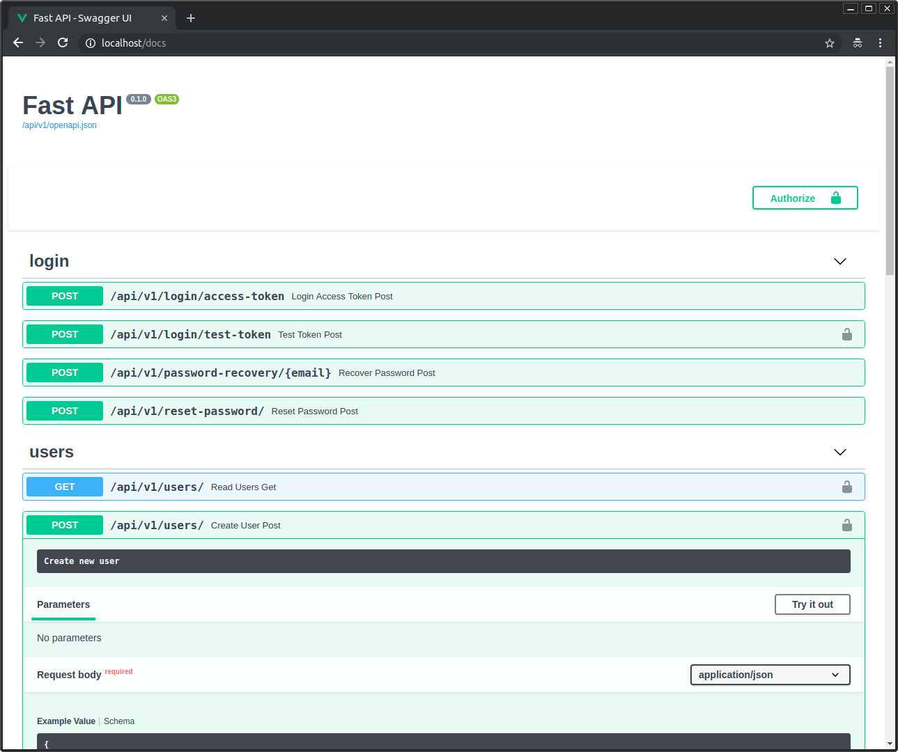

# Full Stack FastAPI Template

<a href="https://github.com/fastapi/full-stack-fastapi-template/actions?query=workflow%3A%22Test+Docker+Compose%22" target="_blank"></a>
<a href="https://github.com/fastapi/full-stack-fastapi-template/actions?query=workflow%3A%22Test+Backend%22" target="_blank"></a>
<a href="https://coverage-badge.samuelcolvin.workers.dev/redirect/fastapi/full-stack-fastapi-template" target="_blank"></a>

## 技术栈与特性

- ⚡ [**FastAPI**](https://fastapi.tiangolo.com) 作为 Python 后端 API。
  - 🧰 [SQLModel](https://sqlmodel.tiangolo.com) 负责 Python 与 SQL 数据库的交互（ORM）。
  - 🔍 [Pydantic](https://docs.pydantic.dev)，被 FastAPI 使用，负责数据校验和配置管理。
  - 💾 [PostgreSQL](https://www.postgresql.org) 作为 SQL 数据库。
- 🚀 [React](https://react.dev) 作为前端。
  - 🧩 构建进后端镜像，由 FastAPI 在与 API 相同的域名下提供服务。
  - 💃 使用 TypeScript、hooks、[Vite](https://vitejs.dev) 等现代前端技术栈。
  - 🎨 [Tailwind CSS](https://tailwindcss.com) 和 [shadcn/ui](https://ui.shadcn.com) 作为前端组件库。
  - 🤖 自动生成的前端客户端。
  - 🧪 [Playwright](https://playwright.dev) 用于端到端测试。
  - 🦇 支持深色模式。
- 🐋 [Docker Compose](https://www.docker.com) 用于开发和生产环境。
- 🔒 默认使用安全的密码哈希。
- 🔑 JWT（JSON Web Token）认证。
- 📫 基于邮件的密码找回。
- 📬 [Mailcatcher](https://mailcatcher.me) 用于开发期间的本地邮件测试。
- ✅ 使用 [Pytest](https://pytest.org) 编写测试。
- 📞 [Traefik](https://traefik.io) 作为反向代理 / 负载均衡器。
- 🚢 基于 Docker Compose 的部署指南，包含如何配置 Traefik 自动处理 HTTPS 证书。
- 🏭 基于 GitHub Actions 的 CI（持续集成）和 CD（持续部署）。

### 控制台登录

[](https://github.com/fastapi/full-stack-fastapi-template)

### 控制台 - 管理员

[](https://github.com/fastapi/full-stack-fastapi-template)

### 控制台 - Items

[](https://github.com/fastapi/full-stack-fastapi-template)

### 控制台 - 深色模式

[](https://github.com/fastapi/full-stack-fastapi-template)

### 交互式 API 文档

[](https://github.com/fastapi/full-stack-fastapi-template)


### 配置

之后你可以更新 `.env` 文件里的配置项来自定义你的配置。

部署之前，至少要修改这几个值：

- `SECRET_KEY`
- `FIRST_SUPERUSER_PASSWORD`
- `POSTGRES_PASSWORD`

你可以（也应该）把它们作为环境变量从密钥管理中传入。

更多细节请阅读 [deployment.md](./deployment.md) 文档。

### 生成密钥

`.env` 文件里有些环境变量的默认值是 `changethis`。

你必须把它们改成密钥，可以运行下面的命令生成：

```bash
python -c "import secrets; print(secrets.token_urlsafe(32))"
```

复制输出内容作为密码 / 密钥。需要另一个密钥就再运行一次。

## 如何使用 - 使用 Copier 的替代方式

本仓库同时支持用 [Copier](https://copier.readthedocs.io) 生成一个新项目。

它会复制所有文件、询问你配置问题，并用你的回答更新 `.env` 文件。

### 安装 Copier

你可以这样安装 Copier：

```bash
pip install copier
```

更推荐的方式是，如果你有 [`pipx`](https://pipx.pypa.io/)，可以直接运行：

```bash
pipx install copier
```

**注意**：如果你有 `pipx`，安装 copier 是可选的，你可以直接运行它。

### 用 Copier 生成项目

先为你的新项目目录想好一个名字，下面会用到。例如 `my-awesome-project`。

进入将作为项目父目录的位置，用你的项目名运行命令：

```bash
copier copy https://github.com/fastapi/full-stack-fastapi-template my-awesome-project --trust
```

如果你有 `pipx` 且没有安装 `copier`，可以直接运行：

```bash
pipx run copier copy https://github.com/fastapi/full-stack-fastapi-template my-awesome-project --trust
```

**注意** `--trust` 选项是必需的，它允许执行一个[项目生成后脚本](https://github.com/fastapi/full-stack-fastapi-template/blob/master/.copier/update_dotenv.py)来更新你的 `.env` 文件。

### 输入变量

Copier 会向你询问一些数据，你可能想提前准备好。

不过别担心，之后都可以在 `.env` 文件里修改。

输入变量及其默认值（部分为自动生成）如下：

- `project_name`：（默认：`"FastAPI Project"`）项目名称，展示给 API 使用者（存于 .env）。
- `stack_name`：（默认：`"fastapi-project"`）用于 Docker Compose 标签和项目名的栈名称（不含空格和句点）（存于 .env）。
- `secret_key`：（默认：`"changethis"`）项目密钥，用于安全相关功能，存于 .env，可用上面的方法生成。
- `first_superuser`：（默认：`"admin@example.com"`）初始超级用户的邮箱（存于 .env）。
- `first_superuser_password`：（默认：`"changethis"`）初始超级用户的密码（存于 .env）。
- `smtp_host`：（默认：""）发送邮件的 SMTP 服务器地址，之后可在 .env 中设置。
- `smtp_user`：（默认：""）发送邮件的 SMTP 服务器用户名，之后可在 .env 中设置。
- `smtp_password`：（默认：""）发送邮件的 SMTP 服务器密码，之后可在 .env 中设置。
- `emails_from_email`：（默认：`"info@example.com"`）发件邮箱账号，之后可在 .env 中设置。
- `postgres_password`：（默认：`"changethis"`）PostgreSQL 数据库密码，存于 .env，可用上面的方法生成。
- `sentry_dsn`：（默认：""）Sentry 的 DSN，如果你使用 Sentry 的话，之后可在 .env 中设置。

## 后端开发

后端文档：[backend/README.md](./backend/README.md)。

## 前端开发

前端文档：[frontend/README.md](./frontend/README.md)。

## 部署

部署文档：[deployment.md](./deployment.md)。

## 开发

通用开发文档：[development.md](./development.md)。

内容包括使用 Docker Compose、自定义本地域名、`.env` 配置等。

## 发布记录

见 [release-notes.md](./release-notes.md) 文件。

## 许可证

Full Stack FastAPI Template 基于 MIT 许可证发布。
